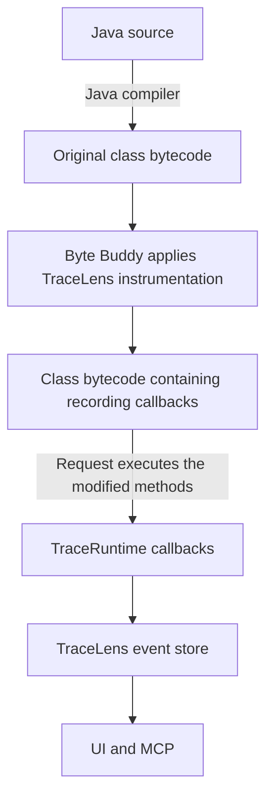

# How TraceLens uses Byte Buddy

Byte Buddy lets TraceLens insert small recording calls into an application's
compiled code, without adding those calls to its Java source. Byte Buddy provides
the machinery for modifying classes; TraceLens decides what to modify, what to
record, and what to do with that information.

This guide explains Java execution, Byte Buddy's role, agent startup,
instrumentation rules, line-number capture, context association, and the supported
boundary hooks. For the rest of the system, see the
[codebase walkthrough](codebase-walkthrough.md), [use cases](use-cases.md), and
[documentation index](README.md).

## 1. What does Java actually execute?

Consider this illustrative application method:

```java
public Feature getFeature(String id) {
    Feature feature = repository.find(id);
    return feature;
}
```

The Java compiler converts the `.java` source into a `.class` file containing
**JVM bytecode**: instructions to load values, call methods, branch, and return
results. The JVM loads those class definitions and executes their methods,
potentially compiling frequently executed code into native machine instructions.

**TraceLens instruments compiled bytecode, not source text in the repository.**
The running service does not need access to its `.java` files to record execution.
Source text is resolved separately when an engineer inspects the recorded data.

## 2. Where Byte Buddy comes in

Byte Buddy is a Java library for creating and modifying classes. Instead of
manually handling every detail of the class-file format, we describe which classes
and methods to modify and what behavior to insert. See the
[Byte Buddy documentation](https://bytebuddy.net/partial/tutorial.partial.html).



There are two distinct phases:

- **When a class loads:** Byte Buddy helps insert the callbacks.
- **When a request runs:** the JVM executes the already-inserted callbacks.

Selected infrastructure transformers also retransform already-loaded classes.
The main application line/method transformer does not; that distinction matters
for late attachment and is explained below.

Byte Buddy is not reading and rewriting the class for every request. Class
transformation has a loading-time cost; executing callbacks has a separate
request-time cost.

### What does inserting callbacks mean?

For a successful execution, the example above becomes conceptually equivalent to
the following, assuming the two executable source statements are on lines 41 and
42 and method tracking is enabled:

```java
public Feature getFeature(String id) {
    TraceRuntime.onMethodEnter(
        "com.example.FeatureService", "getFeature"
    );

    TraceRuntime.onLine("com.example.FeatureService", 41);
    Feature feature = repository.find(id);

    TraceRuntime.onLine("com.example.FeatureService", 42);

    TraceRuntime.onMethodExit(
        "com.example.FeatureService", "getFeature"
    );
    return feature;
}
```

This is an illustration of the successful path, not generated Java source or an
exact bytecode listing. The actual modification happens in bytecode. The original
`.java` file and application JAR are not rewritten: the JVM receives a modified
class definition during loading.

If the method exits by throwing an exception, our full tracing advice emits an
exception event instead of the normal exit event. The example above omits that
exceptional path for clarity.

## 3. How TraceLens gets permission to modify classes

The service is launched with a JVM option shaped like this (replace the path with
the combined distribution JAR):

```bash
-javaagent:/path/to/tracelens.jar=standalone
```

A Java agent is a special JAR that the JVM can initialize before the application's
`main()` method. The JVM calls the agent's entry point:

```java
public static void premain(String args, Instrumentation inst)
```

`Instrumentation` is the JVM-provided interface through which an agent registers
class transformers. A transformer receives class bytes and can return modified
bytes. This is a supported JVM mechanism, not an unofficial modification of JVM
memory. See the
[Java instrumentation documentation](https://docs.oracle.com/en/java/javase/21/docs/api/java.instrument/java/lang/instrument/package-summary.html).

Our entry point is
[`TraceLensAgent.premain`](../tracelens-agent/src/main/java/com/chargebee/tracelens/agent/TraceLensAgent.java).
Its initialization path:

1. Resolves an explicit config file, package property, or standalone empty scope.
2. Makes the small tracing bridge visible across classloaders.
3. Starts the recording runtime in standalone mode.
4. Builds rules for selecting application classes.
5. Uses Byte Buddy to install the transformations.
6. Installs enabled executor/messaging hooks and, in standalone mode, HTTP entry,
   configured identity hooks, and enabled HTTP client instrumentation.

The JVM provides the hook; Byte Buddy makes the hook practical to use; TraceLens
supplies the tracing behavior. See [standalone agent mode](standalone-agent.md)
for complete startup commands.

The [agent build](../tracelens-agent/build.gradle) produces the shaded `-agent.jar`;
the Java bundle delivers it as `tracelens.jar`, also runnable separately as the
viewer/CLI/MCP. The thin JAR is not the launch artifact. Byte Buddy, Jackson, and core are relocated
inside the agent to avoid dependency collisions with the application. The bridge
remains a single, unrelocated bootstrap-visible copy. No application adapter is
required in standalone mode; the Spring Boot and javax adapters are optional
legacy alternatives with their own application-side store/API wiring.

The build toolchain is JDK 21. Main bridge/core/agent sources target Java 8 bytecode,
and explicit smoke fixtures run the delivered agent on Java 8 and Java 21. This
does not imply that every intervening JDK or other installed agent has been tested.
The Spring starter currently inherits the Java 21 compilation target.

Standalone initialization failures are caught so the application can continue
without tracing. Non-standalone initialization failures instead throw. Per-class
weaving errors are logged; successful startup alone does not establish complete
instrumentation coverage.

## 4. How we tell Byte Buddy what to modify

Three concepts connect the configuration to the modified class: matchers, advice,
and a transformer.

### A. Matchers: which classes and methods?

For example, an EMS configuration can select the package `com.chargebee.ems`.
TraceLens's `scopeMatcher` turns that into a Byte Buddy matcher conceptually like:

```java
nameStartsWith("com.chargebee.ems.")
```

The matcher asks: does the class currently being loaded belong to a package we
want to trace? We also apply exclusions and avoid instrumenting TraceLens itself.
Otherwise, recording an event could enter another instrumented TraceLens method,
which records another event, and so on.

Package matching respects the dot boundary: `com.example.app` selects
`com.example.app.*`, not `com.example.application.*`. `excludedPackages` applies
prefix exclusions and `blacklistedNodes` applies class-name substring exclusions.
Although the config schema accepts `modules`, the current `scopeMatcher` does not
use it. A modules-only config is not a working substitute for `packages`.
An empty standalone package list gives no application line/method weaving, while
independent HTTP and other enabled boundary hooks can still record metadata.

Capture policy then decides which callbacks become retained events:
`overview` keeps supported boundary/outcome evidence; `methods` adds scoped
method entry/exit evidence without line events; `detailed` adds line events.
Method/exception switches still apply. `detailedCapturePaths` selects where
method/line detail is retained, and `detailedCaptureUntilEpochMillis` ends that
window with overview fallback. The application transformer still weaves line
callbacks in scope, so a lower capture level reduces retained detail and its
allocation, not all instrumentation or callback cost. SQL/request-data switches
remain independent in all three levels. Configuration changes require restart;
the setup dashboard previews changes and separates saving from confirmed restart.

At the method level, `INSTRUMENTABLE_METHOD` selects concrete Java methods and
excludes abstract, native, and bridge methods. Most synthetic methods are excluded,
but compiler-generated `lambda$...` method bodies are explicitly allowed because
important EMS business logic executes inside lambdas. The class-level matcher
still excludes synthetic classes.

The current method matcher does **not** include constructors or static
initializers. The line visitor is installed only for methods selected by that
matcher.

### B. Advice: what happens when a method enters or exits?

In Byte Buddy terminology, **advice is code inserted at particular points in a
method**. Our actual entry advice is:

```java
@Advice.OnMethodEnter
public static void enter(
        @Advice.Origin("#t") String type,
        @Advice.Origin("#m") String method) {

    TraceRuntime.onMethodEnter(type, method);
}
```

See
[`MethodTraceAdvice.java`](../tracelens-agent/src/main/java/com/chargebee/tracelens/agent/MethodTraceAdvice.java).

- `@Advice.OnMethodEnter` inserts this behavior at method entry.
- `@Advice.Origin("#t")` supplies the declaring type's name.
- `@Advice.Origin("#m")` supplies the method's name.

Those names become constants when the class is instrumented. We are not taking a
stack trace or reflectively discovering the method name on every call.

The advice body is **inlined into the target method**. The inserted code then calls
`TraceRuntime`; it does not need a reflective proxy to intercept each invocation.

For exits, the full tracing advice uses:

```java
@Advice.OnMethodExit(onThrowable = Throwable.class)
```

This distinguishes normal return from an exception escaping the method:

```text
Normal return                       -> METHOD_EXIT
Exception escaping the method       -> EXCEPTION
```

An exception thrown and caught entirely inside the method does not, by itself,
trigger this exceptional-exit advice. In full mode, an exceptional exit emits
`EXCEPTION`, not both `METHOD_EXIT` and `EXCEPTION`.

`selectMethodAdvice` chooses full method/exception advice, methods-only advice,
exceptions-only advice, or no method advice according to `trackMethods` and
`trackExceptions`. The line visitor is installed separately.

| `trackMethods` | `trackExceptions` | Method-boundary events |
| --- | --- | --- |
| `true` | `true` | Entry, normal exit, or escaping exception instead of exit |
| `true` | `false` | Entry and normal exit; escaping exception has no exit event |
| `false` | `true` | Escaping exception only |
| `false` | `false` | No method-boundary events; eligible line events still run |

New callbacks retain class/method names and JVM method descriptors, not arguments,
return values or locals. New events carry a runtime-local thread token, so overloads
and equal thread names can be distinguished. Legacy captures lack these fields;
their name-only evidence remains less precise. Exception capture includes the escaping exception's
type and message, which may itself contain sensitive application data.

### C. Transformer: apply the modifications

The main transformer combines line instrumentation and configured method advice:

```java
DynamicType.Builder<?> out =
    builder.visit(LineEmittingVisitor.forMethods());

if (methodAdvice != null) {
    out = out.visit(methodAdvice);
}
```

See
[`TraceLensAgent.java`](../tracelens-agent/src/main/java/com/chargebee/tracelens/agent/TraceLensAgent.java).
In plain English: for each matching class, insert line callbacks and, when
configured, method-entry/exit/exception callbacks. Byte Buddy installs the
transformation through `.installOn(inst)`.

The main application builder uses `TypeStrategy.Default.REDEFINE`, but does not
enable retransformation of already-loaded application classes. Some separate
infrastructure builders explicitly enable `RedefinitionStrategy.RETRANSFORMATION`.
These settings have different roles; `REDEFINE` alone does not mean that all
already-loaded classes will be revisited. Starting the service with `-javaagent`
is important for business-code capture.

The agent exposes `agentmain`, but it delegates to the same initialization path;
it does not add comprehensive late-attach application retransformation. Rebuild
the shaded JAR and restart the target JVM to pick up an agent change reliably.

## 5. How do we get individual line numbers?

**Method advice and line instrumentation are different mechanisms.** Byte Buddy
advice gives us convenient method-boundary hooks. For line-level recording, we
wrote a lower-level **ASM visitor**, integrated into Byte Buddy through
`AsmVisitorWrapper`. We use Byte Buddy's bundled `net.bytebuddy.jar.asm` classes.

### Where the numbers come from

Compiled methods can contain a `LineNumberTable`: metadata mapping bytecode
positions to original source line numbers. This is optional debugging information,
not the source code itself. See the
[JVM specification](https://docs.oracle.com/javase/specs/jvms/se24/html/jvms-4.html#jvms-4.7.12).

For illustration:

```text
Bytecode position 0 -> source line 41
Bytecode position 8 -> source line 42
```

Our
[`LineEmittingVisitor.java`](../tracelens-agent/src/main/java/com/chargebee/tracelens/agent/LineEmittingVisitor.java)
receives those markers while processing the class:

```java
public void visitLineNumber(int line, Label start)
```

At each eligible marker, it inserts instructions equivalent to:

```java
TraceRuntime.onLine(className, line);
```

The actual instruction-building code is:

```java
mv.visitLdcInsn(fqcn);
mv.visitLdcInsn(line);
mv.visitMethodInsn(
    Opcodes.INVOKESTATIC,
    RECORDER,
    "onLine",
    "(Ljava/lang/String;I)V",
    false
);
```

Translated:

1. Put the class-name string on the JVM operand stack.
2. Put the line-number integer on the stack.
3. Call the static `onLine(String, int)` method.

The descriptor `(Ljava/lang/String;I)V` means: takes a `String` and an `int`, and
returns `void`. The visitor requests `ClassWriter.COMPUTE_FRAMES` so the modified
bytecode has recomputed stack-map frames for JVM verification.

### What a line event does and does not prove

A recorded line means **execution reached the instrumented bytecode marker
associated with that line**. It does not necessarily mean every operation on that
source line completed successfully.

- A loop can produce the same line event repeatedly.
- Comments and blank lines do not represent executable instructions.
- Source lines and bytecode markers are not guaranteed to have a one-to-one mapping.
- Without line-number metadata, this visitor cannot produce source-line events;
  method-boundary advice can still work.
- Source displayed later must match the compiled version to be reliable.
- A missing line event is not proof that a branch never ran: scope, unsupported
  context hops, capture settings, store limits, and eviction also affect visibility.

The current method matcher never selects constructors or static initializers.
Do not infer their coverage from a nearby method's first line marker.

## 6. How does the callback know which request it belongs to?

**Byte Buddy does not know that. TraceLens does.**

When an HTTP request enters, our HTTP instrumentation establishes a TraceLens
context. Later, the injected callback runs:

```java
TraceRuntime.onLine("com.example.FeatureService", 41);
```

Inside
[`TraceRuntime.java`](../tracelens-bridge/src/main/java/com/chargebee/tracelens/bridge/TraceRuntime.java),
we:

1. Check whether a recording sink is registered.
2. Look up the current segment ID from the thread's TraceLens context.
3. Pass the segment ID, class name, and line number to the sink.
4. Let the recording layer create and retain the event, subject to store limits.

The application method does not need a `traceId` parameter. The thread-local
request context supplies the association. The segment ID identifies this
service's local timeline; a distributed trace ID can join multiple such segments.
Local roots ordinarily have `segmentId == traceId`; standalone distributed HTTP
uses W3C trace/span identities and a separate local segment ID. Supported SQS
continuation uses the producer's segment as `parentSegmentId`. These identities
are correlation evidence; matching URLs, topics, or timestamps alone are not.

See
[`TraceContext.java`](../tracelens-bridge/src/main/java/com/chargebee/tracelens/bridge/TraceContext.java)
for context management and
[`TraceSink.java`](../tracelens-core/src/main/java/com/chargebee/tracelens/core/record/TraceSink.java)
for the core recording implementation. For supported asynchronous execution,
TraceLens associates context with unchanged tasks on exact `ThreadPoolExecutor`
instances using exact JDK `LinkedBlockingQueue`, `ArrayBlockingQueue`, or
`SynchronousQueue` queues. Queue subclasses and other/custom queues are skipped.
A bounded weak-identity registry and before/after worker hooks preserve
queue, Future, cancellation and rejection task identity. It tracks admissions even
without a trace: duplicate pending task identities are ambiguous and skip
correlation, so an earlier untraced run cannot inherit a later submission's trace.
Only executor API-mediated submissions/removals are supported; direct mutation of
`getQueue()` bypasses the association hooks and has no correlation guarantee.
Scheduled/custom/ForkJoin executors and unsupported queue shapes
need explicit `TraceContext.wrap` or the application TaskDecorator; they are not
automatically wrapped. An ordinary thread-local does not follow another thread.

The registry retains at most 4,096 pending admissions. At that limit, the admitting
pool is quarantined: its pending associations are discarded and its implicit
propagation stays disabled, while application tasks run unchanged. Successful
`remove` using a task that overrides `equals` also quarantines the pool because the
removed queue entry may have a different identity. Quarantined pools are held
weakly, capped at 256 live entries; exceeding that cap permanently disables all
implicit executor association for the process. This deliberately loses tracing
coverage instead of assigning an uncertain context. Explicit wrappers still work.

If no sink or no active context exists, the callback increments the corresponding
dropped-event counter and returns without storing a line event. **The injected
callback still executes**, so the no-context path is not zero overhead. Active
capture additionally incurs recording and storage work.

`TraceRuntime.emittedCount()` measures forwarding to the sink, not successful
storage. Line/method/exception callbacks now contain observer failures and increment
`observerFailures`; method advice also suppresses extraction failures. Tests preserve
the application's result and original exception when an observer throws. This is
failure containment, not a guarantee against JVM resource exhaustion or every
initialization/transport failure.

### Why do we have a bridge module?

Different parts of an application may be loaded by different classloaders, such
as Tomcat application classes versus JDK classes. All instrumented code must be
able to find the same `TraceRuntime`.

`TraceLensAgent.injectIntoBootstrap` extracts the small embedded bridge JAR and
appends it to the bootstrap classloader's search path. The full Byte Buddy library
is not placed there. This gives inserted calls a shared, reachable destination
without duplicating the entire agent across classloaders.

The distinction to remember is: **Byte Buddy handles code modification; the
TraceLens bridge, context, sink, and store implement the recording behavior.**

## 7. Infrastructure hooks are separate from line weaving

Application package scope does not define every instrumented class. The separate
builders in [TraceLensAgent.java](../tracelens-agent/src/main/java/com/chargebee/tracelens/agent/TraceLensAgent.java),
[HttpInstrumentation.java](../tracelens-agent/src/main/java/com/chargebee/tracelens/agent/HttpInstrumentation.java),
and [HttpClientInstrumentation.java](../tracelens-agent/src/main/java/com/chargebee/tracelens/agent/HttpClientInstrumentation.java)
match particular infrastructure seams by type and method shape:

| Hook | Purpose and scope |
| --- | --- |
| javax/jakarta `Filter.doFilter` and `HttpServlet.service` | Standalone HTTP entry, deduplicated with a private request attribute. Async listeners own eventual completion; each dispatch restores its thread context. |
| Configured `httpIdentityHooks` | Standalone post-authentication identity enrichment at exact configured method seams, independent of package scope. Does not create a trace on its own. |
| `AsyncContext.start(Runnable)` | Standalone servlet task context propagation, including container executors outside the JDK executor hooks. |
| Exact `ThreadPoolExecutor` submission/worker hooks | Associate context without replacing tasks, restore it for execution, then restore prior worker context. At most 4,096 pending associations; unsupported/ambiguous cases skip correlation. No automatic scheduled/custom/ForkJoin coverage. |
| Scoped Spring `@Scheduled` methods | Synthetic job trace lifecycle when `instrumentScheduled` is enabled; this is not a general scheduler adapter. |
| Chargebee `AppJobExecutor.exec(SchJob, Long)` and its audit method | Separate agent dispatcher adapter for exact `chargebeeJobTypes`; each selected attempt creates a scheduler root. Independent of Spring scheduling and HTTP path filters; method/line capture still needs package scope. Audit evidence, not normal return alone, determines job outcome. |
| Scoped `determineCurrentLookupKey` on Spring routing datasources | `DB_ROUTE` metadata, not SQL or confirmed database I/O. |
| Scoped `externalCallClasses` | `EXTERNAL_CALL` wrapper-method entry, not proof of a network request or its success. |
| JDK `HttpURLConnection`/HTTPS boundaries | Standalone outbound HTTP metadata under an active trace; not all HTTP libraries. |
| Synchronous Apache HttpClient 4 `InternalHttpClient` / `MinimalHttpClient` | Supported outbound execution and guarded propagation; overloads deduplicated. Not Apache 5/async or arbitrary custom chains. |
| Supported incoming servlet query and Tomcat body-read seams | Independent, bounded query/body opt-ins. Observe JSON/form input as the application reads it, without consuming unread data; no Authorization/cookie headers or responses. |
| Supported PostgreSQL/MySQL JDBC execution and setter seams | Separate SQL and typed-parameter opt-ins; associate prepared statements without inspecting result rows. |
| Native ClickHouse canonical query seam | Independent SQL/named-binding opt-ins; supported future completion observed without waiting/replacing it. Metadata-only fallbacks stay distinct. |
| AWS SDK v1 SQS sends, Kafka send/poll, supported Queueman handler | Metadata-only messaging boundaries, plus separately enabled legacy SQS continuation. |
| Exact ClickHouse `Client`, supported Spring Data Redis operations/`RedisTemplate`, AWS v1 DynamoDB/S3 clients | Metadata-only known client operations under an active trace, independent of line-capture package scope. No SDK dependency is added to the agent. |

The JDK executor, servlet, HTTP client, and messaging builders use retransformation
because their target classes may already be loaded. Their advice calls the shared
bootstrap bridge; the bridge uses reflective access where concrete servlet/SDK
types belong to application classloaders. Reflection is still runtime work, even
though method-origin strings in the application advice are constants.

[`ChargebeeJobInstrumentation`](../tracelens-agent/src/main/java/com/chargebee/tracelens/agent/ChargebeeJobInstrumentation.java)
also uses retransformation for the exact dispatcher seam, with fail-open advice
calling the bootstrap bridge. It does not instrument every `Job` subclass or
infer an API-to-job link. See [custom-job setup and audit outcomes](cb-app-integration.md#capture-a-chargebee-custom-scheduled-job);
an older agent JAR does not gain this hook merely by receiving a new JSON file.

### Capture is not propagation

`httpIncludePaths` in the selected service JSON controls retained HTTP entries,
independently of package weaving and the outbound settings below. Literal prefixes
match a path or its descendants; omitted means `["/"]`, while `[]` retains no
HTTP entries. Built-in ignored paths still apply. Configuration is loaded at
startup, so edit the JSON and restart the target JVM; do not duplicate the path
list in launcher properties. Filtering an entry can still leave lightweight
distributed context for propagation without a retained local timeline.

`httpClientCaptureEnabled` controls outbound HTTP observation. Its omitted/null
value follows `distributedTracingEnabled` for compatibility; setting it explicitly
true enables local observations with distributed tracing off or for non-allowlisted
peers. Header injection still requires distributed tracing, valid context, an exact
trusted destination, and successful header/redirect guards. If a JDK serialization
guard cannot be installed, propagation is disabled while supported metadata
observation remains possible. Capture false disables new observations/injection.

[`HttpClientTraceRuntime`](../tracelens-bridge/src/main/java/com/chargebee/tracelens/bridge/HttpClientTraceRuntime.java)
records HTTP calls separately from line events. Completion reflects response
headers, error, or disconnect, not full streamed-body consumption. Redirects retain
the original peer/path; they do not create a full redirect-by-redirect timeline.

`captureMessagingBoundaries` similarly controls local metadata capture separately
from `instrumentMessaging`, the existing SQS propagation/Queueman continuation
switch. Omitted/null capture follows that switch. Capture-only mode can start a
local Queueman consumer trace without importing producer context.

`captureDataStoreBoundaries` defaults to `true`; set it to `false` in the selected
service JSON to opt out. [`DataStoreInstrumentation`](../tracelens-agent/src/main/java/com/chargebee/tracelens/agent/DataStoreInstrumentation.java)
matches exact client types and a finite method allowlist. Advice passes constant
type/method names and local throw information to
[`DataStoreBoundaryRuntime`](../tracelens-bridge/src/main/java/com/chargebee/tracelens/bridge/DataStoreBoundaryRuntime.java),
never the client, arguments, results, SQL, keys or URLs. Nested same-system
overloads are deduplicated; the entry segment is retained for the exit event.
Future/CompletionStage-returning methods are marked `SUBMITTED` without awaiting
or inspecting the result. Synchronous return is `OBSERVED`, local throw is
`ERROR`; none proves server execution, cache hit/miss or transaction completion.
Redis `execute`/`executePipelined` can summarize a callback, not individual
commands. The hook adds observations, not propagation or a new trace entry.

`captureJdbcQueries` is an independent, default-off local option.
[`JdbcInstrumentation`](../tracelens-agent/src/main/java/com/chargebee/tracelens/agent/JdbcInstrumentation.java)
weaves supported PostgreSQL/MySQL driver prepare/execute/batch methods.
[`JdbcQueryRuntime`](../tracelens-bridge/src/main/java/com/chargebee/tracelens/bridge/JdbcQueryRuntime.java)
keeps bounded weak statement-to-template associations, correlates execution with
the current captured segment, and emits bounded raw SQL plus elapsed time and
return/error metadata. Nested driver execution and generated preparation are
guarded to avoid duplicate events. The separate `captureJdbcParameters` opt-in
observes successful supported setters and retains bounded typed scalar/null
bindings, including bounded batch snapshots. Advice does not alter arguments,
results, exceptions or transactions. Rows, connection credentials and JDBC
exception messages are not inspected. Unlike the metadata-only hook above, SQL
literals and opted-in bindings are deliberately retained. Display reconstruction
never rewrites the captured template or executes SQL; see
[local SQL capture](jdbc-query-capture.md) for opt-in, limits and sharing cautions.

[`MessagingBoundaryRuntime`](../tracelens-bridge/src/main/java/com/chargebee/tracelens/bridge/MessagingBoundaryRuntime.java)
observes request-object SQS `sendMessage`/`sendMessageBatch`, Kafka producer `send`,
Kafka consumer `poll`, and the supported Queueman `processMessage` boundary. It
does not read bodies, Kafka keys/values, arbitrary record headers, callbacks, or
Future results. Delegated producer overloads are deduplicated. `SUBMITTED` means
local send returned, not delivery acknowledgement. Batch observation adds no SQS
batch propagation, and Kafka observation injects no headers.

Kafka `poll` requires a context already active when the call starts; it neither
creates an arbitrary poll-loop trace nor associates later handler execution with
any particular record. A recorded count covers the whole poll, not each topic.
Queueman normal return means the framework boundary returned; internally caught
failures or skipped business handling can remain invisible. See
[dependency visibility](dependency-visibility-and-change-impact.md) for the full
coverage matrix and evidence interpretation.

## 8. Verification and practical limits

The repository has targeted checks for these seams:

- [LineEmittingVisitorTest](../tracelens-agent/src/test/java/com/chargebee/tracelens/agent/LineEmittingVisitorTest.java)
  and [LoadTimeWeavingTest](../tracelens-agent/src/test/java/com/chargebee/tracelens/agent/LoadTimeWeavingTest.java)
  exercise lambda capture and line/method advice composition, including a fresh
  classloader load-time path.
- [ExecutorWeavingTest](../tracelens-agent/src/test/java/com/chargebee/tracelens/agent/ExecutorWeavingTest.java)
  exercises bootstrap bridge visibility and JDK executor retransformation.
- [HttpClientWeavingTest](../tracelens-agent/src/test/java/com/chargebee/tracelens/agent/HttpClientWeavingTest.java)
  exercises real local HTTP/HTTPS, correlation, redirect safety, and capture-only
  boundaries.
- [MessagingBoundaryWeavingTest](../tracelens-agent/src/test/java/com/chargebee/tracelens/agent/MessagingBoundaryWeavingTest.java)
  exercises real matchers with SDK-shaped, no-network fixtures. It is not a live
  Kafka/SQS delivery test.
- [Standalone smoke tasks](../samples/standalone-smoke/build.gradle) run no-adapter
  servlet applications on Java 8 and Java 21 and include inter-JVM HTTP correlation.
  These are explicit tasks, separate from ordinary unit tests.

`/tracelens/summary` exposes instrumented/failed class counts, bridge drop counts,
configuration, and registration state. `/tracelens/instrumented-classes` provides
a bounded list of main-transformer class names, not a universal inventory of every
infrastructure hook or every method executed. For bytecode inspection,
`-Dtracelens.dumpDir=/path` dumps transformed application classes. The diagnostic
uses simple filenames, so equal simple class names can overwrite one another.
Verify an actual scenario rather than inferring coverage from startup alone.

Summary/metadata also expose `integrationStatus` for application code, JDBC,
ClickHouse and data-store adapters: configured, transformer installed, classes
transformed, and failures are separate facts. A transformed class is not proof
that its intended method executed. `runtimeDiagnostics` reports contained observer
failures, propagated/skipped/pending executor tasks, quarantined pool count, the
global association-disabled flag and skipped SQS propagation. A bounded
SQS carrier includes allowlisted correlation/action identity only, never request
bodies or arbitrary context attributes; conflicts/capacity limits skip propagation.

Callbacks, event allocations, synchronized store appends, reflection, export
serialization, and viewer/MCP processing all have costs. Even dropped/no-context
callbacks execute. No representative production overhead benchmark is established
here; single-request timings are not a benchmark. Narrow scope and intentional
capture are preferable to treating broad line instrumentation as free telemetry.
The optional [four-mode benchmark](performance-insights.md#measuring-agent-overhead)
provides a repeatable synthetic baseline, not a production overhead guarantee.

JVM retention is bounded by segment/event counts, estimated bytes and TTL, not an
exact JVM-heap budget. Segment/store budget drops carry explicit reasons; reserved
capacity protects dependency/error evidence from detail floods without guaranteeing
complete capture. HTTP calls have a separate bounded list. Viewer-file
snapshots, minimized CLI captures and legacy browser pins preserve explicit
copies outside JVM memory; they neither keep JVM traces alive nor create an
automatic shared history service. MCP can reuse the explicitly saved minimized
captures; full snapshots and legacy pins require the viewer's separate projection.

Metadata-only does not mean non-sensitive. Exception messages, user/site labels,
paths, queue/topic names, selected JVM properties, and displayed source can reveal
application data. Body exclusion and sanitized boundary fields do not redact every
other export field. Keep exports, pins, the local viewer/API, and AI inputs within
the application's access and data-handling policies.
