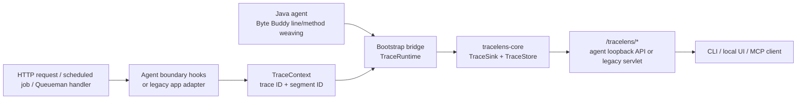

# TraceLens codebase walkthrough

This document explains TraceLens as one end-to-end system: how a request becomes a
trace, how the Java agent records execution, and how engineers or an MCP client
inspect the result. The recommended installation is [standalone agent mode](standalone-agent.md):
one shaded agent, with no TraceLens application dependency. The application-side
adapters described below remain optional legacy integrations.

Start with the [documentation index](README.md) or [use cases](use-cases.md) for
task-oriented guidance. This walkthrough describes the current source, not a
promise of exhaustive runtime coverage or proof that an existing agent JAR or
running service includes the latest source changes.

## End-to-end flow



The design separates three responsibilities:

1. The Java agent observes code execution.
2. The core owns trace lifecycle and retention, inside the agent in standalone mode
   or inside the application adapter in legacy mode.
3. The CLI, UI, and MCP turn retained trace data into useful developer context.

## Module map

| Module | Responsibility |
| --- | --- |
| `tracelens-bridge` | Bootstrap-visible, dependency-free API called from woven bytecode. |
| `tracelens-core` | Framework-independent trace/event model, lifecycle, bounded store, config, and Jackson JSON exporter. |
| `tracelens-agent` | Byte Buddy weaving, servlet/async/client/messaging hooks, and standalone store/debug API. |
| `tracelens-spring-boot-starter` | Optional Spring Boot/jakarta adapter for HTTP entry, lifecycle wiring, and application-route debug API. |
| `tracelens-servlet-javax` | Optional Java 8 / Servlet 3.0 adapter: filter, application-route debug API, async lifecycle. No Spring or Chargebee framework dependency. |
| `tracelens-cli` | Python CLI, local web UI, source renderer, service federation, and MCP server. |
| `samples/line-spike` | Small executable proofs for capture and async propagation behavior. |
| `samples/standalone-smoke` | Plain Java 8/javax and Java 21/jakarta servlet fixtures; actual single-agent integration checks. |

The intended dependency direction is:

```text
woven application classes
        ↓
tracelens-bridge
        ↓
tracelens-core
        ↓
Standalone agent API (or legacy adapter's debug servlet)
        ↓
CLI, local UI, MCP client
```

The [root build](../build.gradle) uses a JDK 21 toolchain. Main sources in the
bridge, core, agent, and javax adapter compile with `--release 8`; the Spring
starter currently inherits the Java 21 target. The standalone compatibility
fixtures exercise Java 8/Tomcat 7 and Java 21/Tomcat 10. This supports the Java 8+
runtime design, but is not a test matrix for every JDK, container, or agent combination.

### Standalone startup and request lifecycle

[`TraceLensAgent.premain`](../tracelens-agent/src/main/java/com/chargebee/tracelens/agent/TraceLensAgent.java)
recognizes `=standalone` (or `-Dtracelens.standalone=true`), resolves configuration
and injects the bridge into the bootstrap loader.
[`StandaloneRuntime`](../tracelens-agent/src/main/java/com/chargebee/tracelens/agent/StandaloneRuntime.java) creates the shaded core
store, event sink, lifecycle listener and a daemon loopback HTTP server. It is
independent of the application's servlet classloader and dependency versions.

`HttpInstrumentation` intercepts standard javax/jakarta filter and servlet entry
points. Its advice calls the dependency-free `HttpTraceRuntime` bridge, which uses
reflection against the actual request/response types. A private request attribute
deduplicates nested filters and servlet calls. A scoped thread-local snapshot ties
woven execution events to this request. Completion records status/timing; async
listeners complete the trace later while each dispatch always clears its own
thread-local scope. `AsyncContext.start` workers receive a captured snapshot.

With no package scope, no application line/method callbacks are installed; standard
HTTP request metadata still works. Other enabled boundary adapters can still
observe their supported operations. Supplying `packages` enables application
weaving. Although config accepts `modules`, the current agent matcher uses only
package prefixes, exclusions, and blacklisted name fragments; a modules-only
configuration does not enable line capture.

The API defaults to `http://127.0.0.1:7778/tracelens`; no application route or
auth exemption is added. Port configuration, entry-path filters, and label rules
are covered in [standalone mode](standalone-agent.md). In standalone startup,
initialization errors are caught and tracing is disabled while the application
continues. The non-standalone agent initialization path instead throws on failure.
The store is bounded in-memory, not durable.

## 1. Bridge: the JVM/classloader seam

Key files:

- [TraceRuntime.java](../tracelens-bridge/src/main/java/com/chargebee/tracelens/bridge/TraceRuntime.java)
- [TraceContext.java](../tracelens-bridge/src/main/java/com/chargebee/tracelens/bridge/TraceContext.java)
- [TraceSnapshot.java](../tracelens-bridge/src/main/java/com/chargebee/tracelens/bridge/TraceSnapshot.java)

Instrumented classes can be loaded by different classloaders. They therefore call a
small static API that is injected into the bootstrap classloader.

`TraceRuntime` receives events from woven code:

```java
TraceRuntime.onLine(fqcn, line);
TraceRuntime.onMethodEnter(fqcn, method);
TraceRuntime.onException(...);
```

It does not store events itself. It checks whether a registered sink and an
active trace context exist, forwards if possible, and otherwise drops the event
while incrementing diagnostic counters. `emitted` counts calls forwarded to the
sink, not events successfully retained: a full or evicted store can reject an event.
The basic line/method/exception callbacks do not catch sink failures. Boundary and
lifecycle callbacks have explicit failure containment, so “never affects the host”
is a design aim, not an unconditional guarantee for every callback.

`TraceContext` keeps the active immutable `TraceSnapshot` in a plain `ThreadLocal`.
It does not use `InheritableThreadLocal`, because that is unsafe with pooled threads.
Instead, `wrap(Runnable)` and `wrap(Callable)` capture a snapshot at submission time
and restore it only for the task execution.

## 2. Core: trace model, lifecycle, and retention

Key files:

- [Trace.java](../tracelens-core/src/main/java/com/chargebee/tracelens/core/trace/Trace.java)
- [TraceEvent.java](../tracelens-core/src/main/java/com/chargebee/tracelens/core/event/TraceEvent.java)
- [TraceStore.java](../tracelens-core/src/main/java/com/chargebee/tracelens/core/store/TraceStore.java)
- [Tracer.java](../tracelens-core/src/main/java/com/chargebee/tracelens/core/record/Tracer.java)
- [TraceSink.java](../tracelens-core/src/main/java/com/chargebee/tracelens/core/record/TraceSink.java)

### Trace IDs and segments

A `traceId` identifies one logical flow. A `segmentId` identifies one concrete
in-process timeline and is the local store key.

- Local-only root traces use `segmentId == traceId`.
- Distributed HTTP capture uses a W3C trace ID and a separate local segment ID;
  `spanId`/`parentSpanId` provide explicit HTTP correlation.
- A supported Queueman consumer continuing propagated SQS metadata creates a new
  segment with the same `traceId` and the producer's segment as `parentSegmentId`.
- Capture-only Queueman entry creates a local trace, without importing producer
  correlation. Kafka poll observation does not create a consumer trace.
- Executor hops remain in the same segment because they restore the same context.

Standalone exports also identify the running `serviceInstanceId`. The viewer
qualifies segment selection with service and instance so restarts or multiple
configured endpoints are not confused with one another.

### Events

`TraceEvent` is a flat event structure. It can
represent:

```text
LINE, METHOD_ENTER, METHOD_EXIT, EXCEPTION,
EXTERNAL_CALL, DB_ROUTE, MARKER
```

Events receive a sequence number when appended to their owning trace. This produces
a per-segment append order even when multiple threads add events; it is not a
globally synchronized clock or proof of cross-thread causality. Messaging
boundaries use `EXTERNAL_CALL` with structured attributes. HTTP client calls live
separately in the export's `httpCalls` list, not in this line-event stream.

### Store

`TraceStore` is a bounded in-memory retention layer:

- retained-segment cap (`maxTrackedRequests`, default 200), evicting the least
  recently active segment when space is needed
- global event cap (`maxTrackedEvents`, default 500,000)
- per-segment event cap (50,000)
- idle TTL sweeper (default 60 minutes)
- recording enable/disable switch for new registrations
- configurable destructive export behavior

Reads do not refresh activity or TTL. HTTP call updates touch activity; ordinary
event appends do too. The per-segment cap sets `truncated`; hitting the global
event cap currently drops appends without setting that flag. A false `truncated`
value therefore does not prove completeness. Disabling recording does not remove
transformers or stop appends to already-retained segments.

HTTP metadata has a separate cap of 64 calls per segment with bounded fields and
`httpCallsTruncated`. These are retention/count bounds, not an exact heap-byte
ceiling: strings, metadata, active lifecycle state, and transient export copies
also use memory. Summary size estimates are approximate.

This is a local/dev/predev debugging store. Restarting a service loses its retained
traces. Browser pins are a separate, browser-local snapshot mechanism, not JVM
retention or a shared backend; see the viewer section below.

### Lifecycle and sink

`Tracer` starts and closes a trace segment. It registers the `Trace`, activates a
`TraceSnapshot`, and restores the previous context on close.

`TraceSink` implements the bridge's sink SPI. It turns bridge callbacks into
`TraceEvent` objects and appends them to the current segment. DB-route events are
change-detected per segment so a busy routing datasource does not flood the trace.

## 3. Agent: line-level Byte Buddy weaving

Key files:

- [TraceLensAgent.java](../tracelens-agent/src/main/java/com/chargebee/tracelens/agent/TraceLensAgent.java)
- [LineEmittingVisitor.java](../tracelens-agent/src/main/java/com/chargebee/tracelens/agent/LineEmittingVisitor.java)
- [MethodTraceAdvice.java](../tracelens-agent/src/main/java/com/chargebee/tracelens/agent/MethodTraceAdvice.java)
- [ExecutorTraceAdvice.java](../tracelens-agent/src/main/java/com/chargebee/tracelens/agent/ExecutorTraceAdvice.java)

At `premain`, the agent loads the file explicitly named by
`-Dtracelens.configPath`, falls back to `-Dtracelens.packages`, or permits empty
scope in standalone mode. It does not discover `tracelens.json` from the working
directory. It injects the bridge jar into the bootstrap classloader, creates
package/exclusion matchers, and installs Byte Buddy transformers.

Without a config file, the agent's `applicationId` fallback is `cb-app`; override
it with `-Dtracelens.applicationId` for a different service. A config file must
still supply an identity, either in JSON or through that JVM override. For the
monolith, `cb-app` is the TraceLens identity and service-registry name;
`chargebee-app` remains the repository and lifecycle/orchestrator name. The
checkout directory is not used to infer the TraceLens identity.

`LineEmittingVisitor` intercepts Java bytecode line-number metadata and inserts an
equivalent of:

```java
TraceRuntime.onLine("com.chargebee.ems.SomeClass", 123);
```

The current matcher includes concrete methods, including synthetic lambda bodies
(`lambda$...`), but excludes constructors, static initializers, native/abstract/
bridge methods, other synthetic methods, and synthetic classes. Line numbers require
compiled debug metadata, and a recorded marker does not prove every operation on
that source line finished successfully.

`MethodTraceAdvice` adds method entry/exit/exception callbacks according to config.
With both tracking options enabled, normal returns emit `METHOD_EXIT`; exceptions
escaping a method emit `EXCEPTION` instead. An internally caught exception is not
itself an exceptional exit. Names contain no method descriptor, so overloads are
not uniquely identified by name alone.

The application transformer acts at class load; it does not retransform already
loaded business classes. The exposed `agentmain` entry point is not a guarantee
of complete late-attach capture. Use startup `-javaagent` and restart after an
agent upgrade. Separate infrastructure transformers do use retransformation.

Executor hooks cover `ThreadPoolExecutor.execute` and supported scheduling methods
on `ScheduledThreadPoolExecutor`; servlet hooks also wrap `AsyncContext.start`.
They do not universally cover raw threads, ForkJoin/common-pool work, reactive
pipelines, or arbitrary custom executors. Scoped `@Scheduled` methods can create
synthetic job traces. Scoped routing datasources emit pool-choice markers, and
configured wrapper classes emit method-entry markers, not confirmed network calls.

See [the Byte Buddy guide](byte-buddy-instrumentation.md) for the detailed weaving
mechanics and [dependency visibility](dependency-visibility-and-change-impact.md)
for observed-evidence limits.

### Outbound HTTP and messaging boundaries

[`HttpClientInstrumentation`](../tracelens-agent/src/main/java/com/chargebee/tracelens/agent/HttpClientInstrumentation.java)
weaves JDK `HttpURLConnection`/HTTPS in standalone mode, independently of package
scope. Under an active trace, it records sanitized peer/path, method, local timing,
status/error, and propagation outcome. Timing stops at response headers/error/
disconnect, not streamed-body completion. This is not coverage of all HTTP clients.

Observation and propagation are separate switches:

- `httpClientCaptureEnabled: true` allows supported outbound observations even
  when `distributedTracingEnabled: false` or the peer is not allowlisted.
  When omitted/null, capture follows the distributed switch for compatibility.
- HTTP propagation still requires distributed tracing, valid W3C context, an exact
  `httpPropagationAllowedDestinations` match, and successful header/redirect safety
  checks. A missing redirect guard disables propagation, not metadata observation.
- `captureMessagingBoundaries` controls metadata-only SQS/Kafka/Queueman capture.
  When omitted/null, it follows `instrumentMessaging` (default true).
  `instrumentMessaging` separately retains single-message SQS attribute injection
  and supported Queueman continuation. Explicit capture-only mode enables no such
  propagation; Kafka never injects record headers.

[`MessagingBoundaryRuntime`](../tracelens-bridge/src/main/java/com/chargebee/tracelens/bridge/MessagingBoundaryRuntime.java)
observes AWS SDK v1 `sendMessage`/`sendMessageBatch` request-object overloads,
`KafkaProducer.send`, `KafkaConsumer.poll`, and the supported Queueman
`processMessage` boundary. It records allowlisted metadata, not payloads, keys,
values, arbitrary headers, callbacks, or Future results. A publish `SUBMITTED`
means the local send method returned, not broker acknowledgement or consumption.
Kafka polls are observed only inside an existing trace; their count is for the
whole poll, not each topic. Queueman normal return proves neither business-handler
success nor commit, because the framework may skip work or catch failures.

Caller boundaries are useful even without a receiver agent. A linked receiver
requires explicit correlation and retained data; aliases, topic names, URLs, and
timestamps do not create that evidence.

## 4. Optional application adapters and debug APIs

Key files:

- [TraceLensAutoConfiguration.java](../tracelens-spring-boot-starter/src/main/java/com/chargebee/tracelens/spring/TraceLensAutoConfiguration.java)
- [TraceLensFilter.java](../tracelens-spring-boot-starter/src/main/java/com/chargebee/tracelens/spring/TraceLensFilter.java)
- [TraceLensDebugServlet.java](../tracelens-spring-boot-starter/src/main/java/com/chargebee/tracelens/spring/TraceLensDebugServlet.java)
- [javax adapter sources](../tracelens-servlet-javax/src/main/java/com/chargebee/tracelens/servlet/)

The starter activates only when `tracelens.enabled=true` and standalone mode is
not selected. It backs off under the standalone agent to avoid creating a second
store, request filter or security exemption.

When it synthesizes configuration without a JSON file, the starter resolves
`tracelens.application-id`, then `spring.application.name`, then `cb-app`.

The HTTP filter reads `tracelens-id` and `tracelens-user` headers, or auto-mints
local labels when strict labels are disabled. It starts the root segment, adds HTTP
metadata, and echoes the segment ID as `X-TraceLens-Id`.

For Servlet async processing, it does not close the trace when the initial dispatch
returns. An `AsyncListener` closes it at completion, timeout, or error instead.

The starter's debug API is a plain `jakarta.servlet.HttpServlet`, not a Spring MVC
controller. The javax adapter provides corresponding wiring for Servlet 3.0 / Java
8. These adapters install an application route, unlike the standalone loopback
server. Do not assume they acquire the standalone HTTP-client weaving simply by
sharing the core. See [standalone mode](standalone-agent.md) before choosing an
adapter for a new installation.

The standalone API includes:

```text
GET  /tracelens/summary
GET  /tracelens/traces
GET  /tracelens/export/{segmentId}
GET  /tracelens/find-by-lens-id/{label}
GET  /tracelens/find-by-trace-id/{traceId}
GET  /tracelens/metadata
GET  /tracelens/instrumented-classes
POST /tracelens/enable | /disable | /reset
POST /tracelens/reset/{segmentId}
```

Use `?evict=false` on export for inspection. Standalone implements this as a plain
read, preserving live completion status. Config-file `evictOnExport` still applies
to ordinary export; only the no-file standalone fallback defaults it to false.

In starter mode, optional reflective contributors enrich HTTP traces with
Chargebee request context and Datadog correlation when those libraries are present.
Standalone uses servlet-principal discovery and explicitly configured
`httpIdentityHooks` for post-authentication identity enrichment; it does not
automatically install those starter contributors.

## 5. CLI, UI, and MCP

The focused productivity path also lives entirely in this reader layer:
[`doctor.py`](../tracelens-cli/tracelens_cli/doctor.py) checks setup;
[`investigation.py`](../tracelens-cli/tracelens_cli/investigation.py) selects an
API/scenario without silently choosing an ambiguous request;
[`captures.py`](../tracelens-cli/tracelens_cli/captures.py) projects, persists and
compares bounded evidence; and
[`workflow.py`](../tracelens-cli/tracelens_cli/workflow.py) shares orchestration
between CLI and MCP. Saved comparisons do not need a live JVM. These files add
no instrumentation or database; see the [developer workflow](developer-workflow.md).

The implemented entry points are:

| CLI | MCP | Purpose |
| --- | --- | --- |
| `doctor` | `tracelens_doctor` | Read-only setup, scope, source-root and retention checks; never starts/restarts services or changes recording. |
| `investigate` | `investigate_request` | Select a retained request by API path, scenario label or exact trace ID; return ambiguity instead of guessing by default. |
| `capture save` | `save_request_capture` | Explicitly save a bounded local evidence projection before eviction or restart. |
| `capture list` | `list_request_captures` | List those local files without fetching live service evidence. |
| `capture compare` | `compare_request_captures` | Compare two saved IDs or unique exact names offline. |

The request investigation preserves sibling/downstream segments when a filter
matches one segment. Its failure signals are evidence to inspect, not an automatic
root-cause finding. Choosing the latest match requires explicit `selection=latest`.

Key files:

- [cli.py](../tracelens-cli/tracelens_cli/cli.py)
- [client.py](../tracelens-cli/tracelens_cli/client.py)
- [render.py](../tracelens-cli/tracelens_cli/render.py)
- [source.py](../tracelens-cli/tracelens_cli/source.py)
- [server.py](../tracelens-cli/tracelens_cli/server.py)
- [mcp_server.py](../tracelens-cli/tracelens_cli/mcp_server.py)

The Python CLI calls the debug API using the standard library. `render.py` turns a
timeline into a readable call tree with thread lanes, relative times, loop-collapse,
and source lines. `source.py` resolves exact `FQCN + line` coordinates against a
local checkout—no embeddings or code index are required.

`tracelens serve` launches a local `127.0.0.1` bridge that serves the vanilla
JavaScript timeline UI and proxies the service debug API.

`tracelens mcp` starts a stdio JSON-RPC MCP server for compatible clients such as
Cursor. For lower-level single-service inspection, use progressive disclosure:

```text
flow_status
    ↓
search_flows("CRI-123")
    ↓
get_flow_summary / get_flow_mermaid
    ↓
get_flow for the relevant segment
    ↓
open the implicated source files and correlate with logs/Datadog
```

The original tools remain: `flow_status`, `list_flows`, `search_flows`,
`get_flow_summary`, `get_flow_mermaid`, and `get_flow`. The current server also
provides `find_actions`/`get_action`, `find_distributed_traces`/
`get_distributed_trace`, `get_trace_visualization`/`show_trace_visualization`,
`get_segment_execution`, and error grouping tools. It uses non-destructive exports.

[`services.py`](../tracelens-cli/tracelens_cli/services.py) federates an explicit
local service registry on demand; it is not a collector. The flow graph separates
caller boundaries from linked receiver execution. The per-segment execution model
reconstructs observed method nesting and source context, with output bounds and
warnings for incomplete events. It is not a complete static call graph or an
automatic changed-method impact index.

The viewer can save filter views and pin snapshots containing the graph and
captured segment data in browser IndexedDB. Current pin limits are 20 snapshots,
5 MiB each, 20 MiB total, subject to browser quota. A successful pin can outlive a
service restart, but it does not protect the JVM copy from eviction, capture
future events, or create a shareable backend record. Pins are browser-local and
are not accessible to MCP. Missing/partial pinned data is reported rather than
silently replaced with live data.

Explicit CLI/MCP file captures are separate from these pins. They default to
`~/.tracelens/captures` or an operator-configured `--capture-dir`, with limits of
20 captures, 5 MiB per capture and 20 MiB total; a full store rejects saves rather
than overwriting or automatically deleting existing captures. The projection
omits payloads, headers, raw exception messages, source text, user/context fields
and thread names. Paths, dependency/code identifiers and supplied labels can
still be sensitive. A supplied revision is a label, not verified runtime build
identity, and snapshots are not atomic across services.

## 6. Worked request example

An engineer sends a request with:

```text
tracelens-id: CRI-123
tracelens-user: engineer@chargebee.com
```

The HTTP entry hook or legacy filter creates segment `T1` and activates it. As the controller, service,
and repository execute, woven bytecode emits method and line callbacks. `TraceRuntime`
routes them to `TraceSink`, which appends them to `T1` in `TraceStore`.

If the controller submits a `Callable` through a supported executor path, executor
advice carries `T1` to its worker thread. A supported outbound HTTP or messaging
call can add a local boundary even with no receiver agent. If single-message SQS
propagation is enabled and the supported Queueman handler receives those fields,
it starts a child segment `T2` with the same logical `traceId` and
`parentSegmentId=T1`. Capture-only mode records independent local boundaries instead.

An MCP client can locate label `CRI-123`, inspect a compact summary or flow graph,
and request the source-aware timeline for the relevant segment. A graph with only
the producer is incomplete evidence, not proof that the receiver failed.

## 7. Samples and verification

The `samples/line-spike` module validates the major mechanics:

- `FullPathSpikeApp`: agent → bridge → sink → store → export
- `LambdaSpikeApp`: synthetic lambda capture and executor propagation
- `SegmentSpikeApp`: root trace and continued SQS-style segment

The repository has Java tests across bridge, core, agent, and starter modules, plus
Python/browser tests for source rendering, federation, local-server/MCP behavior,
boundary projections, and saved snapshots. Important seams include load-time
lambda weaving, JDK executor retransformation, HTTP/HTTPS propagation safety, and
SDK-shaped messaging fixtures. Those messaging fixtures make no broker/network
calls; they verify matching and metadata behavior, not production broker delivery.

Run them with:

```bash
./gradlew test

cd tracelens-cli
uv run --extra test pytest -q
```

Integration checks are explicit Gradle tasks, not implied by `./gradlew test`:

```bash
./gradlew :tracelens-agent:java8Smoke
./gradlew :samples:standalone-smoke:standaloneSmoke
./gradlew :samples:standalone-smoke:distributedSmoke
```

They require installed toolchains for their declared Java versions. The standalone
fixtures have no TraceLens application dependency and cover both servlet namespaces,
metadata-only startup, an occupied debug port, and real inter-JVM HTTP correlation.

## 8. Performance, privacy, and interpretation limits

Line callbacks run for every reached instrumented marker, including when there is
no active context. Active recording adds allocations and a synchronized store
append; reflection, exports, source rendering, and graph layout add further work.
Narrow package/path scope and retention limits reduce cost, but no representative
production overhead benchmark or zero-impact guarantee is established here.

Standalone HTTP and new messaging boundary capture exclude request/message bodies
and arbitrary sensitive headers. That is not “no sensitive data”: path identifiers,
queue/topic names, user/site/action labels, exception messages, source text, and
explicitly configured JVM properties can be sensitive. `capturePayloads` is not a
general redaction control. Protect the local API, viewer, exports, pins, and AI
client inputs under the same access/data policies as the application.

Absent events can mean out-of-scope code, missing line metadata, unsupported async
or client hooks, disabled/rejected capture, dropped events, eviction, or restart.
Only executed, instrumented, retained observations are evidence. Combine them with
source review, logs, contracts, and tests when assessing failure or change impact.
