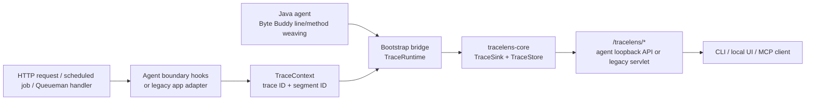

# TraceLens codebase walkthrough

This document explains TraceLens as one end-to-end system: how a request becomes a
trace, how the Java agent records execution, and how engineers or an MCP client
inspect the result. The recommended installation is [standalone agent mode](standalone-agent.md):
one shaded agent, with no TraceLens application dependency. The application-side
adapters described below remain optional legacy integrations.

Start with the [documentation index](README.md) or [use cases](use-cases.md) for
task-oriented guidance. This walkthrough describes the current source, not a
promise of exhaustive runtime coverage or proof that an existing agent JAR or
running service includes the latest source changes.

## End-to-end flow



The design separates three responsibilities:

1. The Java agent observes code execution.
2. The core owns trace lifecycle and retention, inside the agent in standalone mode
   or inside the application adapter in legacy mode.
3. The CLI, UI, and MCP turn retained trace data into useful developer context.

## Module map

| Module | Responsibility |
| --- | --- |
| `tracelens-bridge` | Bootstrap-visible, dependency-free API called from woven bytecode. |
| `tracelens-core` | Framework-independent trace/event model, lifecycle, bounded store, config, and Jackson JSON exporter. |
| `tracelens-agent` | Byte Buddy weaving, servlet/async/client/messaging hooks, and standalone store/debug API. |
| `tracelens-tool` | Current Java setup, CLI, viewer server, federation/source resolution, capture stores and stdio MCP; packaged into the combined JAR. |
| `tracelens-spring-boot-starter` | Optional Spring Boot/jakarta adapter for HTTP entry, lifecycle wiring, and application-route debug API. |
| `tracelens-servlet-javax` | Optional Java 8 / Servlet 3.0 adapter: filter, application-route debug API, async lifecycle. No Spring or Chargebee framework dependency. |
| `tracelens-cli` | Legacy reader/reference implementation plus shared HTML/CSS/JavaScript assets bundled by the current Java tool. |
| `samples/line-spike` | Small executable proofs for capture and async propagation behavior. |
| `samples/standalone-smoke` | Plain Java 8/javax and Java 21/jakarta servlet fixtures; actual single-agent integration checks. |

The intended dependency direction is:

```text
woven application classes
        ↓
tracelens-bridge
        ↓
tracelens-core
        ↓
Standalone agent API (or legacy adapter's debug servlet)
        ↓
CLI, local UI, MCP client
```

The [root build](../build.gradle) uses a JDK 21 toolchain. Main sources in the
bridge, core, agent, and javax adapter compile with `--release 8`; the Spring
starter currently inherits the Java 21 target. The standalone compatibility
fixtures exercise Java 8/Tomcat 7 and Java 21/Tomcat 10. This supports the Java 8+
runtime design, but is not a test matrix for every JDK, container, or agent combination.

### Standalone startup and request lifecycle

[`TraceLensAgent.premain`](../tracelens-agent/src/main/java/com/chargebee/tracelens/agent/TraceLensAgent.java)
recognizes `=standalone` (or `-Dtracelens.standalone=true`), resolves configuration
and injects the bridge into the bootstrap loader.
[`StandaloneRuntime`](../tracelens-agent/src/main/java/com/chargebee/tracelens/agent/StandaloneRuntime.java) creates the shaded core
store, event sink, lifecycle listener and a daemon loopback HTTP server. It is
independent of the application's servlet classloader and dependency versions.

`HttpInstrumentation` intercepts standard javax/jakarta filter and servlet entry
points. Its advice calls the dependency-free `HttpTraceRuntime` bridge, which uses
reflection against the actual request/response types. A private request attribute
deduplicates nested filters and servlet calls. A scoped thread-local snapshot ties
woven execution events to this request. Completion records status/timing; async
listeners complete the trace later while each dispatch always clears its own
thread-local scope. `AsyncContext.start` workers receive a captured snapshot.

With no package scope, no application line/method callbacks are installed; standard
HTTP request metadata still works. Other enabled boundary adapters can still
observe their supported operations. Supplying `packages` enables application
weaving. Although config accepts `modules`, the current agent matcher uses only
package prefixes, exclusions, and blacklisted name fragments; a modules-only
configuration does not enable line capture.

The API defaults to `http://127.0.0.1:7778/tracelens`; no application route or
auth exemption is added. Port configuration, entry-path filters, and label rules
are covered in [standalone mode](standalone-agent.md). In standalone startup,
initialization errors are caught and tracing is disabled while the application
continues. The non-standalone agent initialization path instead throws on failure.
The store is bounded in-memory, not durable.

## 1. Bridge: the JVM/classloader seam

Key files:

- [TraceRuntime.java](../tracelens-bridge/src/main/java/com/chargebee/tracelens/bridge/TraceRuntime.java)
- [TraceContext.java](../tracelens-bridge/src/main/java/com/chargebee/tracelens/bridge/TraceContext.java)
- [TraceSnapshot.java](../tracelens-bridge/src/main/java/com/chargebee/tracelens/bridge/TraceSnapshot.java)

Instrumented classes can be loaded by different classloaders. They therefore call a
small static API that is injected into the bootstrap classloader.

`TraceRuntime` receives events from woven code:

```java
TraceRuntime.onLine(fqcn, line);
TraceRuntime.onMethodEnter(fqcn, method);
TraceRuntime.onException(...);
```

It does not store events itself. It checks whether a registered sink and an
active trace context exist, forwards if possible, and otherwise drops the event
while incrementing diagnostic counters. `emitted` counts calls forwarded to the
sink, not events successfully retained: a full or evicted store can reject an event.
Line/method/exception callbacks contain observer failures and count them separately;
method advice also suppresses observer extraction errors. Boundary and lifecycle
callbacks retain their containment. This does not promise immunity to JVM resource
exhaustion or every initialization/transport failure.

`TraceContext` keeps the active immutable `TraceSnapshot` in a plain `ThreadLocal`.
It does not use `InheritableThreadLocal`, because that is unsafe with pooled threads.
Explicit `wrap(Runnable)` and `wrap(Callable)` capture a snapshot at submission time
and restore it only for task execution. Automatic executor instrumentation instead
uses bounded weak-identity associations on exact `ThreadPoolExecutor` instances,
preserving the original task/Future and queue semantics.

## 2. Core: trace model, lifecycle, and retention

Key files:

- [Trace.java](../tracelens-core/src/main/java/com/chargebee/tracelens/core/trace/Trace.java)
- [TraceEvent.java](../tracelens-core/src/main/java/com/chargebee/tracelens/core/event/TraceEvent.java)
- [TraceStore.java](../tracelens-core/src/main/java/com/chargebee/tracelens/core/store/TraceStore.java)
- [Tracer.java](../tracelens-core/src/main/java/com/chargebee/tracelens/core/record/Tracer.java)
- [TraceSink.java](../tracelens-core/src/main/java/com/chargebee/tracelens/core/record/TraceSink.java)

### Trace IDs and segments

A `traceId` identifies one logical flow. A `segmentId` identifies one concrete
in-process timeline and is the local store key.

- Local-only root traces use `segmentId == traceId`.
- Distributed HTTP capture uses a W3C trace ID and a separate local segment ID;
  `spanId`/`parentSpanId` provide explicit HTTP correlation.
- A supported Queueman consumer continuing propagated SQS metadata creates a new
  segment with the same `traceId` and the producer's segment as `parentSegmentId`.
- Capture-only Queueman entry creates a local trace, without importing producer
  correlation. Kafka poll observation does not create a consumer trace.
- Executor hops remain in the same segment because they restore the same context.

Standalone exports also identify the running `serviceInstanceId`. The viewer
qualifies segment selection with service and instance so restarts or multiple
configured endpoints are not confused with one another.

### Events

`TraceEvent` is a flat event structure. It can
represent:

```text
LINE, METHOD_ENTER, METHOD_EXIT, EXCEPTION,
EXTERNAL_CALL, DB_ROUTE, MARKER
```

Events receive a sequence number when appended to their owning trace. This produces
a per-segment append order even when multiple threads add events; it is not a
globally synchronized clock or proof of cross-thread causality. Messaging
boundaries use `EXTERNAL_CALL` with structured attributes. HTTP client calls live
separately in the export's `httpCalls` list, not in this line-event stream.

### Store

`TraceStore` is a bounded in-memory retention layer:

- retained-segment cap (`maxTrackedRequests`, default 200), evicting least-active
  segments within the eligible channel when space is needed
- HTTP reservation (`httpRetentionPercent`, default 75): HTTP retains a guaranteed
  share of the slots; schedulers, SQS consumers and other background entries share
  the remainder. Either channel can borrow unused **slots**, reclaimed when the
  other channel needs its share. With 200 slots, background churn cannot displace
  the last 150 HTTP segments. New HTTP traffic can still replace older HTTP traces.
- global event cap (`maxTrackedEvents`, default 500,000), split into **fixed** HTTP
  and background budgets (375,000 / 125,000 at the defaults). Event capacity is not
  borrowed: this prevents a large background capture or a newly arriving scheduler
  from evicting HTTP history for event space. Per-event bookkeeping is O(1); scans
  occur on registration/eviction, not on each line callback. Unused event capacity
  in one channel is deliberately unavailable to the other.
- per-segment event cap (50,000)
- estimated retained-data budgets (`maxSegmentBytes`, default 32 MiB;
  `maxTrackedBytes`, default 256 MiB), separate from event-count limits
- reserved capacity for boundaries/exceptions: detail stops before the last
  512 segment events / 1 MiB and the last 4,096 channel events / 8 MiB store bytes
  at the defaults; smaller budgets reserve at most 10% instead
- idle TTL sweeper (default 60 minutes)
- recording enable/disable switch for new registrations
- configurable destructive export behavior

Reads do not refresh activity or TTL. HTTP call updates touch activity; ordinary
event appends do too. Segment, channel and global event/byte drops record explicit
`dropReasons` and truncation/detail-gap metadata. Intentional detail omission is
also reported; methods-only capture does not count its absent line callbacks as
lost method evidence. A false `truncated` value still does not prove complete
application coverage. Disabling recording does not remove
transformers or stop appends to already-retained segments.

HTTP metadata has a separate cap of 64 calls per segment with bounded fields and
`httpCallsTruncated`. These are retention/count bounds, not an exact heap-byte
ceiling: strings, metadata, active lifecycle state, and transient export copies
also use memory. Summary size estimates are approximate.

`httpRetentionPercent: 0` restores the previous shared-budget/least-activity policy.
Nonzero percentages are 1–99, rounded down, with at least one slot/event per channel
when capacity exceeds one. A one-slot store favors HTTP once HTTP is present.
Reservation is not a TTL extension, disk persistence, active-request protection or
a per-endpoint guarantee: idle expiry, explicit resets/destructive exports and
same-channel churn still remove traces. `/tracelens/summary` (starter) or `/summary`
(standalone) exposes `httpRetentionPercent` and `retention` with channel counts,
budgets and lifetime capacity/idle-eviction and budget-drop counters. Updating a
running agent to this policy requires rebuilding its JAR and restarting that JVM.

This is a local/dev/predev debugging store. Restarting a service loses its retained
traces. Explicit viewer-file snapshots and minimized CLI captures preserve
separate local copies; legacy browser pins remain browser-local. None extends JVM
retention or creates automatic shared history; see the viewer section below.

### Lifecycle and sink

`Tracer` starts and closes a trace segment. It registers the `Trace`, activates a
`TraceSnapshot`, and restores the previous context on close.

`TraceSink` implements the bridge's sink SPI. It turns bridge callbacks into
`TraceEvent` objects and appends them to the current segment. DB-route events are
change-detected per segment so a busy routing datasource does not flood the trace.

## 3. Agent: line-level Byte Buddy weaving

Key files:

- [TraceLensAgent.java](../tracelens-agent/src/main/java/com/chargebee/tracelens/agent/TraceLensAgent.java)
- [LineEmittingVisitor.java](../tracelens-agent/src/main/java/com/chargebee/tracelens/agent/LineEmittingVisitor.java)
- [MethodTraceAdvice.java](../tracelens-agent/src/main/java/com/chargebee/tracelens/agent/MethodTraceAdvice.java)
- [ExecutorTraceAdvice.java](../tracelens-agent/src/main/java/com/chargebee/tracelens/agent/ExecutorTraceAdvice.java)

At `premain`, the agent loads the file explicitly named by
`-Dtracelens.configPath`, falls back to `-Dtracelens.packages`, or permits empty
scope in standalone mode. It does not discover `tracelens.json` from the working
directory. It injects the bridge jar into the bootstrap classloader, creates
package/exclusion matchers, and installs Byte Buddy transformers.

The selected service JSON also owns `httpIncludePaths`, alongside packages,
identity hooks and retention. HTTP entry selection uses literal path-or-descendant
prefixes, not wildcard matching. Omission retains the generic `["/"]` default;
explicit `[]` disables retained HTTP entries, and built-in ignored paths still
apply. Launch scripts select the JAR/config path/debug port instead of maintaining
a second HTTP allowlist. Configuration is read at startup and needs an app JVM
restart; the viewer cannot hot-reload it. See the
[cb-app migration rules](cb-app-integration.md#one-json-file-for-capture-settings)
for safely converting older managed startup lists.

`captureMode` has three levels: `overview` retains supported boundaries/outcomes,
`methods` adds scoped method entry/exit, and `detailed` adds line events.
`detailedCapturePaths` narrows method/line retention to selected paths;
`detailedCaptureUntilEpochMillis` falls back to overview after the window ends.
The existing method/exception switches still apply. These are runtime retention
checks before detail allocation, not dynamic removal of woven callbacks. SQL,
bindings and incoming request data have independent opt-ins in every level.

Without a config file, the agent's `applicationId` fallback is `cb-app`; override
it with `-Dtracelens.applicationId` for a different service. A config file must
still supply an identity, either in JSON or through that JVM override. For the
monolith, `cb-app` is the TraceLens identity and service-registry name;
`chargebee-app` remains the repository and lifecycle/orchestrator name. The
checkout directory is not used to infer the TraceLens identity.

`LineEmittingVisitor` intercepts Java bytecode line-number metadata and inserts an
equivalent of:

```java
TraceRuntime.onLine("com.chargebee.ems.SomeClass", 123);
```

The current matcher includes concrete methods, including synthetic lambda bodies
(`lambda$...`), but excludes constructors, static initializers, native/abstract/
bridge methods, other synthetic methods, and synthetic classes. Line numbers require
compiled debug metadata, and a recorded marker does not prove every operation on
that source line finished successfully.

`MethodTraceAdvice` adds method entry/exit/exception callbacks according to config.
With both tracking options enabled, normal returns emit `METHOD_EXIT`; exceptions
escaping a method emit `EXCEPTION` instead. An internally caught exception is not
itself an exceptional exit. New events include a JVM method descriptor and a
runtime-local thread token. Old name-only captures remain readable but cannot
uniquely identify overloads or same-named threads.

The application transformer acts at class load; it does not retransform already
loaded business classes. The exposed `agentmain` entry point is not a guarantee
of complete late-attach capture. Use startup `-javaagent` and restart after an
agent upgrade. Separate infrastructure transformers do use retransformation.

Executor hooks cover exact `ThreadPoolExecutor` instances with unchanged tasks;
servlet hooks also wrap `AsyncContext.start`. Scheduled/custom executors, raw
threads, ForkJoin/common-pool work and reactive pipelines need explicit context
propagation. Unsupported or ambiguous automatic associations are skipped, not
guessed. Scoped `@Scheduled` methods can create
synthetic job traces. Separately,
[`ChargebeeJobInstrumentation`](../tracelens-agent/src/main/java/com/chargebee/tracelens/agent/ChargebeeJobInstrumentation.java)
matches the exact `AppJobExecutor.exec(SchJob, Long)` dispatcher and audit seam,
independent of application package scope. A nonempty `chargebeeJobTypes` allowlist
selects runtime job types; each selected dispatch gets a separate scheduler root,
not an inferred child of the API that scheduled it. Recognized audit outcomes
determine success/failure/skipping; normal return alone does not prove success.
The hook is independent of `instrumentScheduled` and `httpIncludePaths`, but
method/line evidence still needs scoped packages. See
[custom-job configuration and limits](cb-app-integration.md#capture-a-chargebee-custom-scheduled-job).
Scoped routing datasources emit pool-choice markers, and
configured wrapper classes emit method-entry markers, not confirmed network calls.

See [the Byte Buddy guide](byte-buddy-instrumentation.md) for the detailed weaving
mechanics and [dependency visibility](dependency-visibility-and-change-impact.md)
for observed-evidence limits.

### Outbound HTTP and messaging boundaries

[`HttpClientInstrumentation`](../tracelens-agent/src/main/java/com/chargebee/tracelens/agent/HttpClientInstrumentation.java)
weaves JDK `HttpURLConnection`/HTTPS in standalone mode, independently of package
scope. Under an active trace, it records sanitized peer/path, method, local timing,
status/error, and propagation outcome. Timing stops at response headers/error/
disconnect, not streamed-body completion. This is not coverage of all HTTP clients.

The separate Apache adapter covers synchronous HttpClient 4 `InternalHttpClient`
and `MinimalHttpClient` seams, with one logical operation through response
headers/error. It has guarded host/port propagation and nested-overload
deduplication; Apache 5/async and arbitrary client chains are not covered. See
[HTTP adapter contracts](distributed-tracing.md#apache-httpclient-4).

Observation and propagation are separate switches:

- `httpClientCaptureEnabled: true` allows supported outbound observations even
  when `distributedTracingEnabled: false` or the peer is not allowlisted.
  When omitted/null, capture follows the distributed switch for compatibility.
- HTTP propagation still requires distributed tracing, valid W3C context, an exact
  `httpPropagationAllowedDestinations` match, and successful header/redirect safety
  checks. A missing redirect guard disables propagation, not metadata observation.
- `captureMessagingBoundaries` controls metadata-only SQS/Kafka/Queueman capture.
  When omitted/null, it follows `instrumentMessaging` (default true).
  `instrumentMessaging` separately retains single-message SQS attribute injection
  and supported Queueman continuation. Explicit capture-only mode enables no such
  propagation; Kafka never injects record headers.

[`MessagingBoundaryRuntime`](../tracelens-bridge/src/main/java/com/chargebee/tracelens/bridge/MessagingBoundaryRuntime.java)
observes AWS SDK v1 `sendMessage`/`sendMessageBatch` request-object overloads,
`KafkaProducer.send`, `KafkaConsumer.poll`, and the supported Queueman
`processMessage` boundary. It records allowlisted metadata, not payloads, keys,
values, arbitrary headers, callbacks, or Future results. A publish `SUBMITTED`
means the local send method returned, not broker acknowledgement or consumption.
Kafka polls are observed only inside an existing trace; their count is for the
whole poll, not each topic. Queueman normal return proves neither business-handler
success nor commit, because the framework may skip work or catch failures.

Caller boundaries are useful even without a receiver agent. A linked receiver
requires explicit correlation and retained data; aliases, topic names, URLs, and
timestamps do not create that evidence.

## 4. Optional application adapters and debug APIs

Key files:

- [TraceLensAutoConfiguration.java](../tracelens-spring-boot-starter/src/main/java/com/chargebee/tracelens/spring/TraceLensAutoConfiguration.java)
- [TraceLensFilter.java](../tracelens-spring-boot-starter/src/main/java/com/chargebee/tracelens/spring/TraceLensFilter.java)
- [TraceLensDebugServlet.java](../tracelens-spring-boot-starter/src/main/java/com/chargebee/tracelens/spring/TraceLensDebugServlet.java)
- [javax adapter sources](../tracelens-servlet-javax/src/main/java/com/chargebee/tracelens/servlet/)

The starter activates only when `tracelens.enabled=true` and standalone mode is
not selected. It backs off under the standalone agent to avoid creating a second
store, request filter or security exemption.

When it synthesizes configuration without a JSON file, the starter resolves
`tracelens.application-id`, then `spring.application.name`, then `cb-app`.

The HTTP filter reads `tracelens-id` and `tracelens-user` headers, or auto-mints
local labels when strict labels are disabled. It starts the root segment, adds HTTP
metadata, and echoes the segment ID as `X-TraceLens-Id`.

For Servlet async processing, it does not close the trace when the initial dispatch
returns. An `AsyncListener` closes it at completion, timeout, or error instead.

The starter's debug API is a plain `jakarta.servlet.HttpServlet`, not a Spring MVC
controller. The javax adapter provides corresponding wiring for Servlet 3.0 / Java
8. These adapters install an application route, unlike the standalone loopback
server. Do not assume they acquire the standalone HTTP-client weaving simply by
sharing the core. See [standalone mode](standalone-agent.md) before choosing an
adapter for a new installation.

The standalone API includes:

```text
GET  /tracelens/summary
GET  /tracelens/traces
GET  /tracelens/export/{segmentId}
GET  /tracelens/find-by-lens-id/{label}
GET  /tracelens/find-by-trace-id/{traceId}
GET  /tracelens/metadata
GET  /tracelens/instrumented-classes
POST /tracelens/enable | /disable | /reset
POST /tracelens/reset/{segmentId}
```

Use `?evict=false` on export for inspection. Standalone implements this as a plain
read, preserving live completion status. Config-file `evictOnExport` still applies
to ordinary export; only the no-file standalone fallback defaults it to false.

In starter mode, optional reflective contributors enrich HTTP traces with
Chargebee request context and Datadog correlation when those libraries are present.
Standalone uses servlet-principal discovery and explicitly configured
`httpIdentityHooks` for post-authentication identity enrichment; it does not
automatically install those starter contributors.

## 5. CLI, UI, and MCP

The current distribution runs this layer with `java -jar tracelens.jar` in a
separate JVM, not inside the application agent. `tracelens-tool` contains
`ToolMain`, `ViewerServer`, `McpServer`, `Federation`, `Visualization`, `Execution`,
`Source`, `ViewerSnapshotStore`, `CaptureStore` and `SetupInstaller`.
The shared browser assets live under `tracelens-cli/tracelens_cli/web/` and are
embedded in the Java JAR; their directory name does not imply a runtime dependency.
For current invocation/setup contracts, see [Java distribution](java-distribution.md).

Setup prepares cb-app, EMS, Plans, Ledger or GO independently. Reruns load/edit
capture settings with backups; additions preserve unrelated settings and saved
namespaces. Per-service failures are isolated, and the viewer also keeps healthy-service evidence when another
agent is unreachable. Saving configuration does not restart applications; a
separate confirmed action manages registered Tomcat/JAR children without adopting
IDE/custom processes. Setup does not build applications. UI middleware
is not an installer option.

The productivity path lives entirely in this reader layer: `Doctor` checks setup,
`GuidedInvestigation` checks exact API capture readiness, and `Investigation`
selects evidence without silently choosing an ambiguous request. `Captures`,
`CaptureTools` and `BehaviorComparison` project, search and compare saved
evidence; `Workflow` shares orchestration between CLI and MCP. Saved comparisons
do not need a live application JVM. This layer adds no instrumentation or database;
see the [developer workflow](developer-workflow.md).

The implemented entry points are:

| CLI | MCP | Purpose |
| --- | --- | --- |
| `doctor` | `tracelens_doctor` | Read-only setup, scope, source-root and retention checks; never starts/restarts services or changes recording. |
| `diagnose` | `diagnose_capture_request` | Read-only exact-path capture checks and retained matches; missing metadata remains unknown, not an inferred readiness pass. |
| `investigate` | `investigate_request` | Select a retained request by API path, scenario label or exact trace ID; return ambiguity instead of guessing by default. |
| `capture save` | `save_request_capture` | Explicitly save a bounded local evidence projection before eviction or restart. |
| `capture list` | `list_request_captures` | List those local files without fetching live service evidence. |
| `capture compare` | `compare_request_captures` | Compare two saved IDs or unique exact names offline. |
| `capture search` | `search_saved_captures` | Bounded literal lookup of classes, methods, exception types and destinations in minimized capture files only. |

The request investigation preserves sibling/downstream segments when a filter
matches one segment. Its failure signals are evidence to inspect, not an automatic
root-cause finding. Choosing the latest match requires explicit `selection=latest`.
The viewer's **Start an investigation** panel uses the same readiness checks.
Its explicitly armed 60/120-second watch waits for one new, completed, unambiguous
request, then saves a viewer snapshot. It does not replay APIs, broaden recording
scope or change the agent. Ambiguity and incomplete discovery stop selection.

`DebugClient`, `Federation`, `Renderer` and `Source` read evidence, render call
trees and resolve observed `FQCN + line` coordinates against a configured local
checkout—no embeddings or code index are required. The earlier Python reader
was removed on 2026-11-24; its behavior is frozen in the committed parity
fixtures under `tracelens-tool/src/test/resources`.
Native request-body/query and ClickHouse capture are separate
agent opt-ins documented in [request data and native SQL](request-data-and-clickhouse.md).
The UI exposes Requests, Saved captures, Performance and Services/capture settings.
Fixed-size graph cards open an adjacent inspector for inputs, SQL and Copy actions;
focus controls and a bounded minimap help navigate large flows without resizing
cards. Request-data keyword search is explicit and bounded. Grouped SQL, cache
and queue cards retain their own evidence semantics; compact/fit defaults and call-order labels are explained
in [hybrid visualization](hybrid-visualization.md).

`java -jar tracelens.jar serve` launches a local `127.0.0.1` bridge that serves the vanilla
JavaScript timeline UI and proxies the service debug API.

`java -jar tracelens.jar mcp` starts a stdio JSON-RPC MCP server for compatible clients such as
Cursor. For lower-level single-service inspection, use progressive disclosure:

```text
flow_status
    ↓
search_flows("CRI-123")
    ↓
get_flow_summary / get_flow_mermaid
    ↓
get_flow for the relevant segment
    ↓
open the implicated source files and correlate with logs/Datadog
```

The original tools remain: `flow_status`, `list_flows`, `search_flows`,
`get_flow_summary`, `get_flow_mermaid`, and `get_flow`. The current server also
provides `find_actions`/`get_action`, `find_distributed_traces`/
`get_distributed_trace`, `get_trace_visualization`/`show_trace_visualization`,
`get_segment_execution`, and error grouping tools. It uses non-destructive exports.

`Federation` reads an explicit local service registry on demand; it is not a
collector. Its bounded shared admission pool isolates partial/unavailable services.
The flow graph separates
caller boundaries from linked receiver execution. The per-segment execution model
reconstructs observed method nesting and source context, with output bounds and
warnings for incomplete events. It is not a complete static call graph or an
automatic changed-method impact index.

The segment detail page offers **Code flow**, **Call tree** and **Timeline / source**.
`web/app.js` sends an allowlisted loaded projection or an exact paged segment
reference to `POST /api/segment-execution`. `ViewerServer` uses the same `Execution`
model builder as MCP. Live paged reads are bounded; saved reconstruction reads
only the selected saved evidence, never live replacement data or a newer checkout.
`web/execution-graph.js` renders bounded HTML
cards/SVG nesting connectors with zoom, collapsed subtrees and source-event
drill-down; `web/code-flow.js` provides the complementary ordered code-flow view.
Both support search over retained reconstructed nodes, match navigation and a
selected-branch focus that preserves observed ancestry. Code flow can reversibly
fold wrappers into an application-logic view; it does not delete observations.
Unplaced HTTP has a separate labeled search section, never invented method
ownership. Omitted/raw events are not silently added to model search. **Open local
source** explicitly resolves an existing observed coordinate under the configured
source root and offers editor links; it does not execute a server shell or prove
that today's checkout matches the captured build. HTTP observations stay separate
when method ownership is unknown.
This is viewer-only computation: no Java instrumentation or runtime dependency
is added. See [bounds and evidence rules](hybrid-visualization.md#segment-execution-flow).

**Save snapshot** uses `ChunkedSnapshotStore` for upgraded agents: the server
captures bounded pages and pinned source into a version-2 manifest/compressed
chunks under `~/.tracelens/viewer-snapshots/<namespace>/chunked-v2`.
`serve --snapshot-dir` overrides the root. Limits are 20 captures, 128 MiB raw /
64 MiB compressed each, and 512 MiB raw / 256 MiB compressed per namespace's
chunked store. Legacy version-1 JSON snapshots remain supported separately at
20 files, 5 MiB each and 20 MiB total. Full stores reject saves rather than
silently evicting evidence. See [paging, concurrency and all quotas](java-capture-storage.md).
Stable snapshot
links work across browsers using the same viewer and storage, even after service
restart, but are not public links. Missing/partial data is reported rather than
silently replaced with live evidence. Legacy browser pins remain in IndexedDB;
**Save to viewer** copies one explicitly, preserving the original. Saved filter
views remain browser-local.

Explicit CLI/MCP file captures are separate from full snapshots and browser pins. They default to
`~/.tracelens/captures` or an operator-configured `--capture-dir`, with limits of
20 captures, 5 MiB per capture and 20 MiB total; a full store rejects saves rather
than overwriting or automatically deleting existing captures. The projection
omits payloads, headers, raw exception messages, source text, user/context fields
and thread names. Paths, dependency/code identifiers and supplied labels can
still be sensitive. A supplied revision is a label, not verified runtime build
identity, and snapshots are not atomic across services.

The **Saved captures** workspace lets developers choose a Before/After pair for
**Compare & search saved captures**. Its behavior review leads with request
outcomes, external calls and parent-level changed methods, with nested changes
expandable. Service aliases improve labels without changing matching identities;
comparability gaps remain visible. Evidence inspection preserves the comparison
pair and return context. Search reads bounded evidence across both local stores;
large chunked captures use an explicitly limited per-segment analysis prefix,
not a full historical index. **Use with CLI/MCP**
creates a new minimized capture from the selected snapshot, leaving the full
original unchanged. CLI/MCP list/compare/search tools use that new capture ID,
not the viewer snapshot UUID; they cannot directly read full snapshots or browser
pins. Configure the same global `--capture-dir` for viewer and CLI/MCP when
overriding the default. No-result searches and unchanged comparisons do not prove
unused code or safety; see [workflow limits](developer-workflow.md).

## 6. Worked request example

An engineer sends a request with:

```text
tracelens-id: CRI-123
tracelens-user: engineer@chargebee.com
```

The HTTP entry hook or legacy filter creates segment `T1` and activates it. As the controller, service,
and repository execute, woven bytecode emits method and line callbacks. `TraceRuntime`
routes them to `TraceSink`, which appends them to `T1` in `TraceStore`.

If the controller submits a `Callable` through a supported executor path, executor
advice carries `T1` to its worker thread. A supported outbound HTTP or messaging
call can add a local boundary even with no receiver agent. If single-message SQS
propagation is enabled and the supported Queueman handler receives those fields,
it starts a child segment `T2` with the same logical `traceId` and
`parentSegmentId=T1`. Capture-only mode records independent local boundaries instead.

An MCP client can locate label `CRI-123`, inspect a compact summary or flow graph,
and request the source-aware timeline for the relevant segment. A graph with only
the producer is incomplete evidence, not proof that the receiver failed.

## 7. Samples and verification

The `samples/line-spike` module validates the major mechanics:

- `FullPathSpikeApp`: agent → bridge → sink → store → export
- `LambdaSpikeApp`: synthetic lambda capture and executor propagation
- `SegmentSpikeApp`: root trace and continued SQS-style segment

The repository has Java tests across bridge, core, agent, and starter modules, plus
browser tests for the viewer. Important seams include load-time
lambda weaving, JDK executor retransformation, HTTP/HTTPS propagation safety, and
SDK-shaped messaging fixtures. Those messaging fixtures make no broker/network
calls; they verify matching and metadata behavior, not production broker delivery.

Run them with:

```bash
./gradlew test
node --test tracelens-cli/tests/*.test.cjs
```

Integration checks are explicit Gradle tasks, not implied by `./gradlew test`:

```bash
./gradlew :tracelens-agent:java8Smoke
./gradlew :samples:standalone-smoke:standaloneSmoke
./gradlew :samples:standalone-smoke:distributedSmoke
```

They require installed toolchains for their declared Java versions. The standalone
fixtures have no TraceLens application dependency and cover both servlet namespaces,
metadata-only startup, an occupied debug port, and real inter-JVM HTTP correlation.

## 8. Performance, privacy, and interpretation limits

Line callbacks run for every reached instrumented marker, including when there is
no active context. Active recording adds allocations and a synchronized store
append; reflection, exports, source rendering, and graph layout add further work.
Narrow package/path scope and retention limits reduce cost, but no representative
production overhead benchmark or zero-impact guarantee is established here.

Incoming servlet query parameters and supported Tomcat request bodies have separate
bounded opt-ins; supported SQL and bindings can also be enabled deliberately.
Message bodies, auth/cookie headers and HTTP responses are not captured. That is
not “no sensitive data”: request inputs, SQL, path identifiers,
queue/topic names, user/site/action labels, exception messages, source text, and
explicitly configured JVM properties can be sensitive. `capturePayloads` is not a
general redaction control. Protect the local API, viewer, exports, pins, and AI
client inputs under the same access/data policies as the application.

Absent events can mean out-of-scope code, missing line metadata, unsupported async
or client hooks, disabled/rejected capture, dropped events, eviction, or restart.
Only executed, instrumented, retained observations are evidence. Combine them with
source review, logs, contracts, and tests when assessing failure or change impact.
